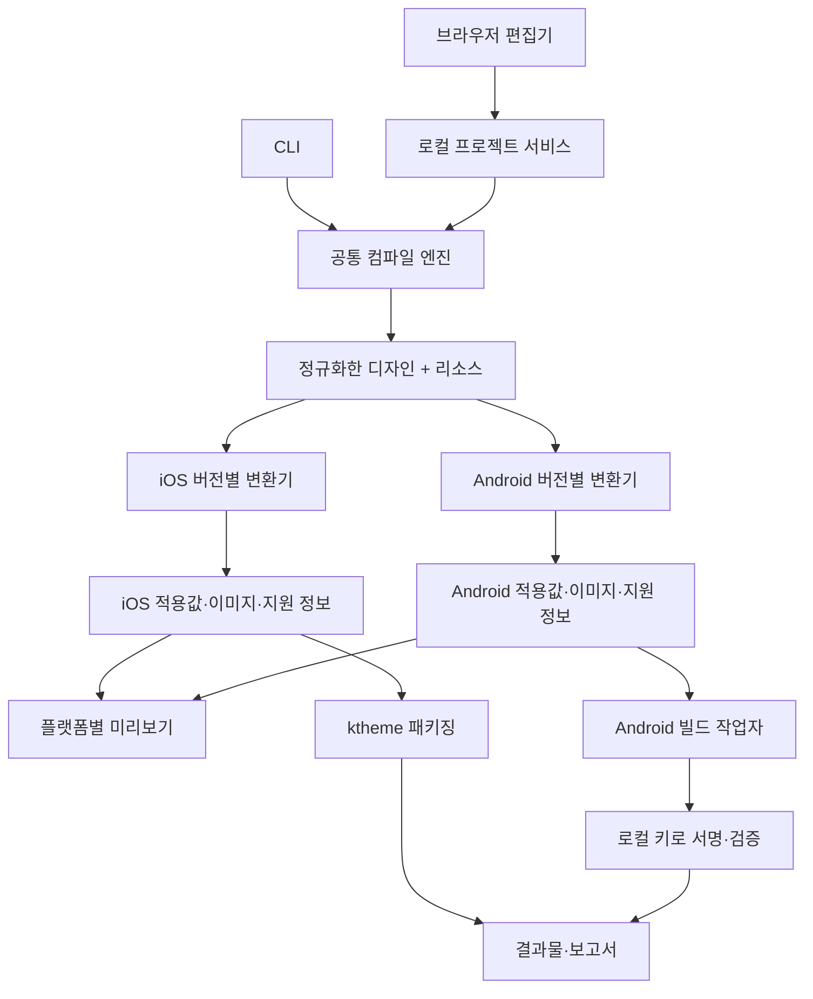

# 카카오톡 테마 제작 도구 설계안

작성일: 2026-10-25 (한국 시간)
상태: 구현 전 설계. 사용자 확정 사항은 자체 서명키 생성 및 APK 자동 서명이다. 나머지는 아래 기본안으로 제안한다.

## 1. 목표와 초기 범위

사용자는 리소스와 디자인 정책을 한 번 정의하고, iOS·Android 예상 화면을 확인한 다음, 한 번의 생성 작업으로 `.ktheme`와 자체 서명한 설치용 `.apk`를 얻는다. 같은 프로젝트를 다시 열어 수정하고 다음 버전을 만들 수 있어야 한다.

초기 실행 환경은 현재 작업 환경인 **macOS의 로컬 웹 편집기**로 가정한다. 브라우저 UI와 로컬 프로세스가 함께 동작한다. 테마 출력 대상이 iOS·Android라는 점과 제작 도구 자체의 지원 OS는 별개다. Windows 실행, 설치형 데스크톱 패키징, 다중 사용자 웹 서비스는 후속 범위로 둔다.

초기 테마 호환성 기준은 조사한 공식 샘플 26.9.0이다. '현재 모든 카카오톡 버전 지원'으로 표시하지 않고 실제 검증한 카카오톡·OS·화면 조합을 기록한다. 첫 지원은 한국어 휴대폰 세로 화면이다. 태블릿·가로·지역별 탭은 리소스 매핑에서 구분하고 검증 범위를 후속 확대한다.

### 첫 제품에 포함할 기능

- 프로젝트 생성, 자동 저장, 다시 열기, 이동 가능한 프로젝트 ZIP 내보내기·가져오기.
- 자체 기본 테마에서 시작하고 색상·이미지·말풍선·아이콘·기본 프로필·잠금화면을 편집.
- iOS·Android 나란히 미리보기: 친구 목록, 채팅 목록, 채팅방, 잠금화면.
- 일반/선택/누름 상태와 짧은/긴/연속 메시지 검토. 지원 상태는 플랫폼별로 다르게 표시.
- 색·크기·리소스 참조·늘림 영역·플랫폼 지원 여부 검증.
- 제작자용 서명키 생성·선택·암호화 백업·복원.
- `.ktheme`, 서명 및 검증을 마친 `.apk`, 미리보기 PNG, 빌드 보고서 생성.
- CLI에서 같은 프로젝트를 검증·생성하여 UI와 별개로 반복 작업 가능.

라이트·다크는 별도 변형으로 저장하고 각각 패키지를 생성한다. 최초 완료 기준은 한 변형의 두 플랫폼 생성이며, 변형별 일괄 출력은 그 이후 확장한다. 시스템 모드에 따라 한 테마의 두 팔레트가 자동 전환되는 기능은 목표에 포함하지 않는다.

## 2. 사용자 경험

### 첫 실행

1. 로컬 빌드 환경 상태를 점검한다. JDK/SDK가 없으면 필요한 항목과 설치 상태를 보여준다. 실행용 최소 명령과 초기 다운로드 절차를 문서화한다.
2. 제작자 이름을 입력하고 '제작자 서명키 생성'으로 키를 만든다. 이미 보유한 키는 가져올 수 있다.
3. 기본 테마 프로젝트를 생성한다. 테마 내부 ID와 플랫폼별 ID를 한 번만 발급한다.
4. 배경과 대표색만 변경해도 파일을 생성할 수 있다. 나머지는 도구 자체 기본 자산으로 채운다.

초기 버전은 설치 스크립트/런처를 제공하고, 사용자가 매번 Android Studio를 조작하지 않게 한다. 개발 환경 배포와 일반 사용자용 설치 프로그램은 구분한다. SDK 등 외부 도구의 배포 가능 범위·초기 다운로드를 고려해 '모든 도구 무조건 번들'은 전제로 삼지 않는다.

### 편집 화면

```text
┌ 프로젝트 이름 / 저장 상태 / 실행취소·다시실행 / 검증 / 두 플랫폼 생성 ┐
│ 화면·리소스 목록 │ iOS 예상 화면 │ Android 예상 화면 │ 선택 항목 설정 │
│ 배경            │              │                  │ 색상·이미지    │
│ 글자·강조색     │              │                  │ 상태·여백      │
│ 말풍선          │              │                  │ 플랫폼별 보정  │
│ 탭·프로필       │              │                  │                │
│ 잠금화면        │              │                  │                │
├ 검증 결과 / 자동 대체 항목 / 선택 화면의 지원 범위 / 빌드 상태        ┤
└────────────────────────────────────────────────────────────────────┘
```

화면의 요소를 선택하면 대응하는 정책으로 이동한다. 글자색 변경 등 지원되는 값과, 실제 카카오톡에서 제어할 수 없는 배치는 구분해 표시한다. 일반 사용자 흐름에는 CSS/XML 파일명·Gradle 설정을 노출하지 않고 진단 상세 화면에 둔다.

### 리소스와 디자인 정책

| 영역 | 입력 | 동작 |
|---|---|---|
| 팔레트 | 배경, 제목, 보조 글자, 강조, 입력창, 보낸/받은 글자 | 공통 의미별 토큰을 플랫폼 속성으로 변환 |
| 배경 | 원본, 잘림 초점, 미리 가공할 방향 | 실제 슬롯의 크롭 방식에 맞춰 출력 |
| 말풍선 | 보낸/받은, 첫/연속, 지원되는 선택 상태 | 공통 템플릿 또는 사용자 이미지 |
| 말풍선 기하 | 늘림 영역, 내용 여백 | iOS 표현 가능 범위 검사 및 Android 9-patch 생성 |
| 아이콘 | 역할, 일반/선택 이미지, 안전 여백 | 프로필이 지원하는 탭 슬롯에 배치 |
| 기본 리소스 | 기본 프로필, 잠금 배경·불릿·키패드 | 지정 가능한 범위만 편집 |
| 예외 | iOS 또는 Android 전용 설정 | 공통값 위에 명시적으로 적용 |

공통값 → 변형값 → 플랫폼별 예외 순으로 적용한다. 프로젝트 데이터에서 임의 플랫폼 CSS/XML 삽입은 허용하지 않고 지원 항목을 타입으로 표현한다. 팔레트에서 계산한 기본 누름색 등은 사용자가 덮어쓸 수 있으며 자동 생성 여부를 표시한다.

말풍선 편집기는 단순한 둥근 말풍선 템플릿으로 먼저 완성한다. 사용자 이미지를 넣으면 늘림 가이드와 내용 영역을 겹쳐 보여주고 짧은/긴 메시지로 즉시 확인한다. Android의 복수 늘림 구간처럼 iOS 형식에 그대로 대응하지 않는 입력은 공통 모드에서 제한하거나 플랫폼 전용 리소스로 분리한다.

## 3. 구조와 데이터 흐름



핵심은 **편집 데이터 → 플랫폼별 실제 적용값 → 미리보기와 파일 생성**의 순서를 공유하는 것이다. 두 플랫폼 모두를 같은 가상 화면에 색만 바꿔 보여주는 구조를 피한다.

### 모듈 책임

| 모듈 | 책임 | 주요 산출물 |
|---|---|---|
| `theme-core` | 스키마, 기본값, 토큰 해석, 정책, 스키마 마이그레이션 | 정규화된 디자인, 진단 |
| `asset-pipeline` | 이미지 검사·변환, 크롭, 밀도/배율, 9-patch | 생성 이미지와 변환 메타데이터 |
| `adapter-ios` | 프로필별 CSS·이미지 매핑, 지원 범위 | iOS 적용값, 파일 트리 |
| `adapter-android` | 프로필별 색상·상태·manifest·이미지 매핑 | Android 적용값, 프로젝트 파일 트리 |
| `preview` | 변환 결과와 공통 샘플 데이터를 사용해 화면 렌더링 | 예상 화면, PNG |
| `local-service` | 프로젝트 저장, 자산 관리, 환경 진단, 작업 큐 | 로컬 API, 진행 이벤트 |
| `android-builder` | 고정 도구 환경에서 컴파일, 정렬, 서명, 검증 | 설치용 APK, 진단 |
| `signing-store` | 제작자 키 관리, fingerprint 확인, 백업·복원 | 키 프로필 참조 |
| `cli` | 검증·생성·환경 점검 진입점 | 자동화 가능한 명령 |

기술 기본안은 React/TypeScript UI, TypeScript 공통 엔진, Node.js 로컬 서비스, Sharp 이미지 처리, Android 공식 빌드 도구다. UI 개발 서버는 Vite를 사용할 수 있다. CLI와 서비스는 동일 엔진을 호출한다. 정확한 라이브러리 버전은 구현 시작 시 호환성을 확인하고 lockfile로 고정한다.

저장은 프로젝트 폴더와 JSON을 기본으로 한다. 첫 버전에 별도 데이터베이스는 필요하지 않다. 작업 상태는 작은 로컬 인덱스로 보관하고, 앱 재시작 시 미완료 작업을 '중단됨'으로 복구한다.

## 4. 프로젝트와 컴파일 계약

```text
my-theme/
  theme.json                 # 사용자가 편집하는 정의
  assets/originals/          # 원본 이미지
  project.lock.json         # 템플릿/프로필/컴파일러와 자산 해시
  .local/                    # 이 장비의 키 연결·작업 이력, 이동용 ZIP 제외
  output/<build-id>/         # 생성 시점의 결과물
```

`theme.json`의 핵심 필드는 `schemaVersion`, `identity`, `metadata`, `targets`, `tokens`, `assets`, `bubbles`, `variants`, `platformOverrides`, `policies`다. 앞선 `theme-spec.example.json`은 검토용 초안이므로 구현 전 이 계약으로 정리하고 JSON Schema를 작성한다.

- `identity`: 프로젝트 UUID와 고정된 플랫폼 ID. 표시 이름을 바꿔도 패키지 ID는 유지한다.
- `assets`: 역할, 원본 상대 경로, 원본 해시, 기준 크기, 배율, 크롭 초점, 출처 메모. 생성 이미지가 원본을 덮어쓰지 않는다.
- `bubbles`: 좌표계를 논리 단위로 명시하고 여백은 top/left/bottom/right 이름으로 저장한다. 출력 배율에서 픽셀로 환산한다.
- `targets`: 플랫폼별 어댑터 프로필, 지원 화면 프로필. 처음은 조사한 26.9.0을 기준으로 검증한다.
- `policies`: 누락 필수 자산은 오류 또는 명시한 기본값 적용, 지원하지 않는 값은 경고/오류, 이미지 확대 경고 등.

컴파일 결과는 `platform`, `profileVersion`, `projectRevision`, `resolvedStyles`, `generatedAssets`, `fileTree`, `capabilities`, `diagnostics`를 담는다. 미리보기는 `resolvedStyles`와 실제 `generatedAssets`를 읽는다. 설치 파일 생성도 같은 파일 트리를 사용한다.

진단은 `code`, `severity`, `platform`, `fieldPath`, `assetId`, `message`, `suggestedFix`를 가진다. 편집기는 fieldPath를 통해 오류 항목으로 이동한다. 검증되지 않은 필드는 지원됨으로 표시하지 않는다.

자동 저장은 안전한 임시 파일 작성 후 교체한다. 편집 중 생성 요청은 그 시점의 불변 스냅샷을 만든다. 사용자가 이후 편집하더라도 진행 중 빌드에 섞이지 않는다. 완료 결과에는 생성한 프로젝트 revision을 표시한다.

## 5. 자체 서명키 관리

### 기본 방식

제작자 프로필당 **자체 release 서명키 하나를 생성하고 여러 테마에 재사용**한다. 각 테마·변형의 패키지 ID는 별개다. 임시 debug 키는 개발 테스트에서만 사용하고, 사용자 내보내기 기본값은 제작자 release 키다.

키 저장소는 사용자 전용 앱 데이터 디렉터리에 암호화한 PKCS12/JKS로 저장한다. 초기 Mac 버전에서는 저장소 비밀번호를 OS Keychain에 보관하는 방식을 우선 구현한다. 프로젝트에는 키 ID와 예상 인증서 SHA-256 fingerprint만 기록하며, 개인키와 비밀번호는 넣지 않는다.

키 생성은 JDK keytool, APK 서명·검증은 Android apksigner를 사용한다. 비밀번호는 명령줄 리터럴과 로그에 넣지 않는다. 도구가 지원하는 표준입력 또는 자식 프로세스 전용 환경을 사용하고 민감값은 진단에서 제거한다. 새 프로필에서 동시 요청이 들어와도 키가 중복 생성되지 않도록 잠근다.

### 유지·백업·복원

- 테마별 최초 내보내기 때 패키지 ID와 서명 fingerprint 연결을 저장한다.
- 이후 내보내기에서 키가 없거나 fingerprint가 달라지면 중단하고 복원 또는 새 테마로 복제 경로를 제공한다. 새 키를 조용히 생성해 대체하지 않는다.
- 키 백업은 사용자가 정한 백업 비밀번호로 암호화한다. 앱 로그인·프로젝트 ZIP과 분리한다.
- 프로젝트를 다른 장비로 가져오면 해당 키를 따로 복원하고 fingerprint가 일치하는지 확인한다.
- '사본 저장'은 같은 테마 ID를 유지하고, '새 테마로 복제'는 새 플랫폼 ID를 발급한다.
- Android 배포 versionCode는 테마·변형마다 증가시킨다. 작업 생성 때 잠금으로 예약하고 같은 작업 재시도는 같은 예약값을 사용한다. 실패로 번호가 비어도 역행하지 않는다.

서명은 제작자 일관성과 무결성을 위한 것이며, 카카오의 승인이나 모든 단말의 설치 허용을 뜻하지 않는다. 사용자 안내에는 기기에서 요구하는 외부 앱 설치 허용 절차를 제공한다.

## 6. 빌드와 결과물

작업 상태: `대기 → 검증 → 리소스 변환 → iOS 패키징 / Android 컴파일 → Android 정렬 → 서명 → 서명 검증 → 완료`. 각 플랫폼 상태를 별도로 기록하고 일부 성공은 그대로 표시한다. Android 실패 시 성공한 ktheme도 받을 수 있다. '두 플랫폼 완료'는 둘 다 성공한 경우에만 표시한다.

Android의 SDK/JDK/Gradle 조합은 먼저 실제 빌드로 확정한다. 조사한 샘플의 Java 21 설정과 Kotlin 컴파일 타깃, 누락된 settings 파일 등을 정리해 자체 재현 가능한 템플릿을 만든다. 사용자에게 임의 Gradle 스크립트를 입력받지 않고 고정된 템플릿에 검증된 설정·리소스만 적용한다.

수동 서명 경로는 `unsigned APK → zipalign → apksigner sign → apksigner verify`로 단일화한다. 서명 뒤 APK를 수정하지 않는다. 빌드 결과의 패키지 ID·버전·인증서·리소스도 검사한다. 자세한 순서는 [apksigner 공식 문서](https://developer.android.com/tools/apksigner)를 따른다.

한 내보내기의 결과:

```text
output/<build-id>/
  theme-ios.ktheme
  theme-android.apk
  previews/ios-chat.png
  previews/android-chat.png
  build-report.json
  install-guide.ko.html
```

보고서에는 입력 revision, 자산 해시, 어댑터·템플릿·도구 버전, 대체/미지원 항목, 플랫폼별 성공 상태, 패키지 ID/versionCode/인증서 fingerprint, 결과물 체크섬을 기록한다. 서명 비밀번호·개인키·사용자 절대 경로는 넣지 않는다. 파일 생성 재현성과 디버깅을 목표로 하며, 서로 다른 실행의 서명된 APK 바이트가 항상 동일하다고 약속하지 않는다.

최초 도구·의존성 설치에는 네트워크가 필요할 수 있다. 캐시를 준비한 뒤의 오프라인 빌드 가능 여부는 별도 검증해 표시한다. 취소 시 하위 빌드 프로세스까지 종료하고 부분 결과는 완료 파일로 노출하지 않는다.

## 7. 미리보기와 검증

미리보기는 플랫폼별 화면 셸과 동일한 고정 샘플 대화를 사용한다. 단순 CSS 전체 확대 대신 늘림 영역과 내용 여백을 해석한다. Android 9-patch는 실제 생성 파일의 가이드 정보를 해석하고, iOS는 생성된 인셋·늘림 설정을 해석한다. 플랫폼별 구조·텍스트 표시 차이는 별도로 유지한다.

색상 편집은 빠르게 반영하고, 이미지 변환은 Web Worker 또는 로컬 서비스의 비동기 작업으로 수행한다. 화면에 적용된 revision을 표시해 느린 이전 변환이 최신 결과를 덮어쓰지 않게 한다. 미리보기 정확도 표시는 '예상 화면', 실제 검증 기록은 '기기 확인'으로 구분한다.

검증 계층:

1. 입력: 타입·색상·이미지 포맷·픽셀 수·필수 자산·ID·좌표 범위.
2. 변환: 속성 지원 여부·이름/배율·투명도·인셋·늘림 영역·이미지 참조.
3. 패키지: ktheme 루트 구조·CSS/이미지 참조, APK 컴파일·ID·서명.
4. 미리보기: 짧은/긴/여러 줄/연속 메시지, 상태별 자산, 다양한 화면 폭의 캡처.
5. 실제 앱: 대상 카카오톡에서 목록 인식·적용·실제 말풍선과 배경·같은 키의 다음 버전 업데이트.

테스트는 변환 계약과 실제 오류를 잡는 경우에 집중한다. 알파 채널 순서, 인셋 좌표·배율, 9-patch 가이드, 버전별 필드 매핑, 키 불일치와 작업 부분 실패를 필수 회귀 대상으로 삼는다. 실제 앱 검증은 설치 가능한 휴대폰과 카카오톡 계정이 준비된 환경에서 수행하며, 준비 전에는 '미검증' 상태로 남긴다. 미리보기 오차는 이미지 잘림·늘림·여백을 우선 보정하고 시스템 글꼴·줄바꿈까지 픽셀 단위 일치를 완료 기준으로 삼지 않는다.

## 8. 로컬 실행 경계

로컬 서비스는 loopback에만 바인딩하고 세션 토큰·Origin 검사를 적용한다. 자산 경로는 프로젝트 루트 안으로 제한하고 프로젝트 ZIP 가져오기에서 경로 이탈·과도한 압축 해제를 차단한다. 업로드 이미지에는 포맷·크기 제한을 적용하고 SVG 외부 참조는 차단한다. 명령 실행은 인자 배열로 전달하며 shell을 사용하지 않는다.

공식 샘플의 파일 이름과 구조를 참고하되 사용자 결과물의 기본 이미지는 자체 중립 자산으로 교체한다. 고정 템플릿·의존성 checksum과 lockfile을 관리한다. 로컬 키는 프로젝트 파일과 분리한다. 이 경계는 일반 편집 화면에 체크리스트로 노출하지 않고 구현과 진단 기능에서 처리한다.

## 9. 후속 확장

- Windows용 로컬 실행과 OS별 비밀 저장소.
- 설치형 데스크톱 앱으로 편집기·서비스 패키징.
- 태블릿·가로·지역별 탭 및 신규 카카오톡 프로필.
- 색상 변형 일괄 생성, 고급 말풍선·아이콘 템플릿.
- 선택적 서버 빌드. 로컬 키를 자동 업로드하는 방식으로 전환하지 않고 서버용 키 소유·보관 모델을 별도로 설계.

## 참고 근거

- 기존 조사: `feasibility-review.ko.md`, 샘플 정적 검사: `inspection.json`.
- [카카오 공식 가이드·샘플 안내](https://cs.kakao.com/helps_html/1073209428?locale=ko)
- [Android 서명](https://developer.android.com/studio/publish/app-signing)
- [apksigner](https://developer.android.com/tools/apksigner)
- [9-patch](https://developer.android.com/studio/write/draw9patch)
- [Node.js 자식 프로세스](https://nodejs.org/api/child_process.html)
- [Sharp 이미지 처리](https://sharp.pixelplumbing.com/)

외부 문서는 파일 규격·서명·도구 동작의 근거다. UI, 모듈 분리, 저장 방식, 단계별 범위는 본 설계의 제안이다.
